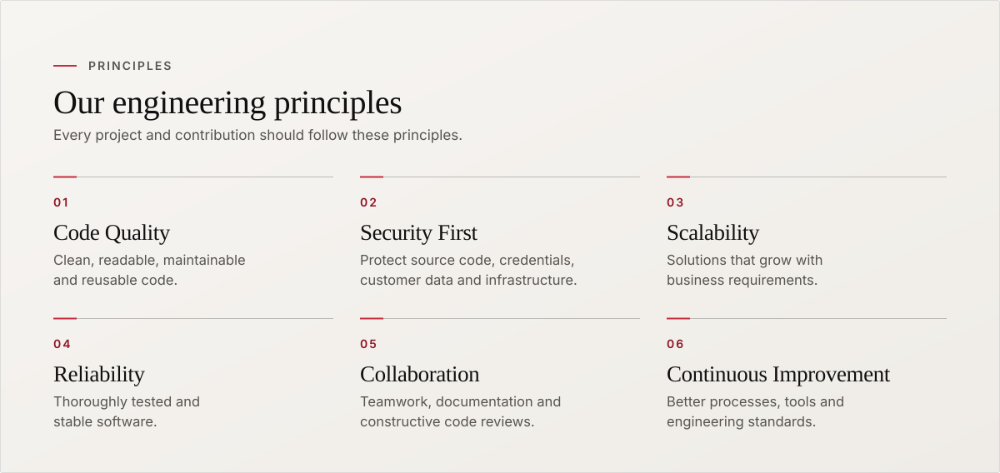
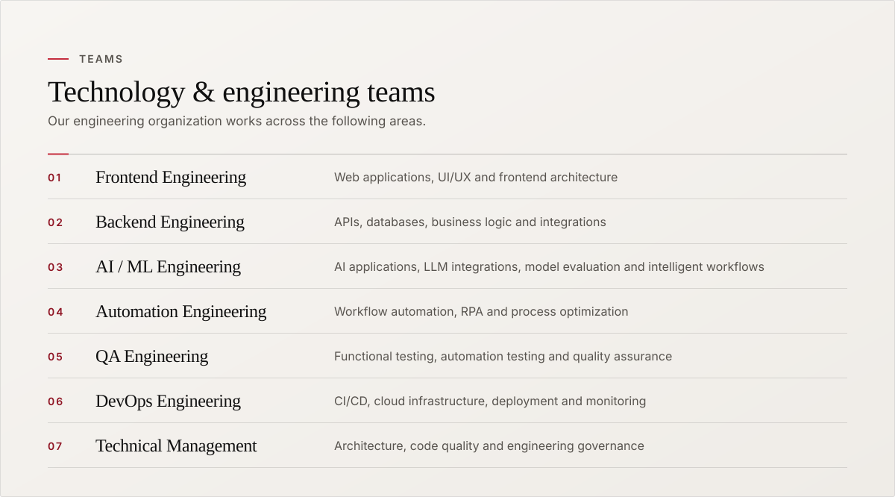

<!--
  ZIU AI organization profile
  Repo: github.com/ziuai/.github  ->  file: profile/README.md  (images in profile/assets/)
  The artwork follows the ZIU AI website theme and comes in a light and a dark variant.
  It is generated: edit tools/build-profile-assets.mjs and run `node tools/build-profile-assets.mjs`.
-->

  <picture>
    <source media="(prefers-color-scheme: dark)" srcset="https://raw.githubusercontent.com/ziuai/.github/main/profile/assets/header-dark.svg"/>
    
  </picture>

<h3 align="center">Welcome to the official GitHub organization of ZIU AI.</h3>

  We build software products, AI-powered applications, automation solutions and scalable technology platforms. 
  Our engineering approach focuses on <b>quality</b>, <b>security</b>, <b>maintainability</b>, <b>performance</b> and <b>continuous improvement</b>. 
  This organization is the central workspace for our engineering projects and collaborative development.

  <picture>
    <source media="(prefers-color-scheme: dark)" srcset="https://raw.githubusercontent.com/ziuai/.github/main/profile/assets/divider-dark.svg"/>
    
  </picture>

  <picture>
    <source media="(prefers-color-scheme: dark)" srcset="https://raw.githubusercontent.com/ziuai/.github/main/profile/assets/principles-dark.svg"/>
    
  </picture>

  <picture>
    <source media="(prefers-color-scheme: dark)" srcset="https://raw.githubusercontent.com/ziuai/.github/main/profile/assets/teams-dark.svg"/>
    
  </picture>

  <picture>
    <source media="(prefers-color-scheme: dark)" srcset="https://raw.githubusercontent.com/ziuai/.github/main/profile/assets/pipeline-dark.svg"/>
    
  </picture>

  <picture>
    <source media="(prefers-color-scheme: dark)" srcset="https://raw.githubusercontent.com/ziuai/.github/main/profile/assets/standards-dark.svg"/>
    
  </picture>

<b>01 &nbsp;·&nbsp; Account & Organization Guidelines</b>

 

- Use your approved professional company email for organization membership.
- Every team member must use their own GitHub account.
- Enable **Two-Factor Authentication (2FA)**.
- Never share passwords, authentication codes or recovery codes.
- Do not transfer company code into personal repositories.
- Follow assigned repository and team permissions.

<b>02 &nbsp;·&nbsp; Repository Management</b>

 

- Use meaningful and consistent repository names.
- Keep project documentation updated.
- Include a `README.md` in every project repository.
- Maintain an appropriate `.gitignore` file.
- Do not commit build artifacts, temporary files or unnecessary dependencies.
- Keep company source code in authorized organization repositories.

<b>03 &nbsp;·&nbsp; Branching Strategy</b>

 

| Branch | Purpose |
|---|---|
| `main` | Production-ready code |
| `development` | Integrated development |
| `feature/*` | New feature development |
| `bugfix/*` | Bug fixes |
| `hotfix/*` | Urgent production fixes |
| `release/*` | Release preparation |

**Examples:** `feature/user-authentication` · `feature/ai-document-processing` · `bugfix/api-validation` · `hotfix/production-error` · `release/v1.2.0`

> **Direct pushes to protected production and development branches are not permitted.**

<b>04 &nbsp;·&nbsp; Pull Request Guidelines</b>

 

All code changes must be submitted through **Pull Requests**.

**Every Pull Request should include:**
- A clear and meaningful title
- Description of the changes
- Related task or issue ID
- Implementation details
- Testing performed
- Screenshots for UI changes, where applicable
- Potential impact on APIs, databases and integrations

**Before merging:**
- Required code reviews must be completed
- All required CI/CD checks must pass
- Review comments must be resolved
- Required approvals must be obtained

<b>05 &nbsp;·&nbsp; Coding Standards</b>

 

**General Coding Practices**
- Write clean, readable and maintainable code.
- Follow the language-specific formatting and linting standards.
- Use meaningful variable, function and class names.
- Avoid duplicate code and unnecessary complexity.
- Keep functions and modules focused on specific responsibilities.
- Handle exceptions and errors properly.
- Avoid hardcoded configuration values.
- Remove unused imports, debugging statements and dead code.
- Add comments where business logic requires clarification.
- Write appropriate unit and integration tests.

**Code Organization**
- Follow the established project architecture.
- Separate business logic, presentation and data-access layers appropriately.
- Use reusable components and shared utilities.
- Maintain consistent folder structures.
- Update technical documentation when architecture or functionality changes.

**Code Review** — every contributor must:
- Review code carefully before submitting a PR.
- Provide constructive and professional feedback.
- Check functionality, readability, security and performance.
- Avoid approving code without understanding the changes.

<b>06 &nbsp;·&nbsp; AI & Machine Learning Development Standards</b>

 

AI and ML projects require additional validation and responsibility.

- Maintain version-controlled prompts and model configurations.
- Document model names, versions and important parameters.
- Validate AI-generated code before merging.
- Evaluate model accuracy, reliability and consistency.
- Maintain relevant test cases and evaluation datasets.
- Monitor model performance and unexpected outputs.
- Protect confidential datasets and customer information.
- Never commit API keys, tokens or production credentials.
- Follow approved AI services and data-handling policies.

<b>07 &nbsp;·&nbsp; API & Integration Guidelines</b>

 

- Follow consistent API naming conventions.
- Use appropriate HTTP status codes.
- Validate incoming requests.
- Implement proper authentication and authorization.
- Handle errors consistently.
- Document API contracts and integration requirements.
- Maintain backward compatibility where required.

<b>08 &nbsp;·&nbsp; Security & Data Protection</b>

 

> **Security is everyone's responsibility.**

**Never commit or publish:**
- API keys and access tokens
- Passwords and authentication credentials
- Private certificates and secret keys
- Confidential customer documents
- Personally identifiable information
- Proprietary datasets or restricted business information

**Additional requirements:**
- Store secrets using approved secret-management solutions.
- Review third-party dependencies for vulnerabilities.
- Follow least-privilege access principles.
- Report security vulnerabilities through authorized company channels.
- Do not expose internal infrastructure or production configurations publicly.

<b>09 &nbsp;·&nbsp; Testing & Quality Assurance</b>

 

- Developers must test their changes before submitting PRs.
- Write unit tests for appropriate business logic.
- Perform integration testing for APIs and services.
- Validate UI functionality across supported environments.
- QA must verify assigned changes before release.
- Document defects with clear reproduction steps.
- Critical and high-severity defects must be resolved before production deployment.
- Maintain release notes and testing evidence.

<b>10 &nbsp;·&nbsp; DevOps & Deployment Standards</b>

 

- Use approved CI/CD workflows.
- Keep deployment configurations version-controlled.
- Separate development, staging and production environments.
- Restrict production deployment permissions.
- Maintain deployment logs and monitoring.
- Define rollback procedures for production releases.
- Do not perform unauthorized infrastructure changes.
- Protect CI/CD credentials and deployment secrets.

<b>11 &nbsp;·&nbsp; Documentation Standards</b>

 

| Document | Purpose |
|---|---|
| `README.md` | Project overview and setup |
| `CONTRIBUTING.md` | Contribution guidelines |
| `CHANGELOG.md` | Version and release history |
| `SECURITY.md` | Security reporting policy |
| `LICENSE` | Approved licensing terms |
| API Documentation | API usage and integration details |

Documentation should be clear, accurate and updated alongside code changes.

<b>12 &nbsp;·&nbsp; Collaboration & Professional Conduct</b>

 

- Communicate respectfully with all team members.
- Link development work to approved tasks or issues.
- Keep Pull Requests and assigned tasks updated.
- Inform the responsible lead about blockers.
- Share technical knowledge and support team members.
- Respect repository ownership and access permissions.
- Follow company-approved development and release processes.

<b>13 &nbsp;·&nbsp; Contribution Workflow</b>

 

1. Get access to the appropriate repository.
2. Review project documentation and coding standards.
3. Create a feature or bug-fix branch.
4. Implement changes following project conventions.
5. Run relevant tests and validations.
6. Commit changes with meaningful messages.
7. Create a Pull Request.
8. Address review feedback.
9. Obtain required approvals.
10. Merge after all required checks pass.

  <picture>
    <source media="(prefers-color-scheme: dark)" srcset="https://raw.githubusercontent.com/ziuai/.github/main/profile/assets/divider-dark.svg"/>
    
  </picture>

  <i>We believe strong engineering comes from continuous learning, accountability and collaboration. 
  Every team member contributes to building reliable, secure and scalable technology.</i>

  <picture>
    <source media="(prefers-color-scheme: dark)" srcset="https://raw.githubusercontent.com/ziuai/.github/main/profile/assets/footer-dark.svg"/>
    
  </picture>

ZIU AI &nbsp;·&nbsp; Official GitHub Organization

